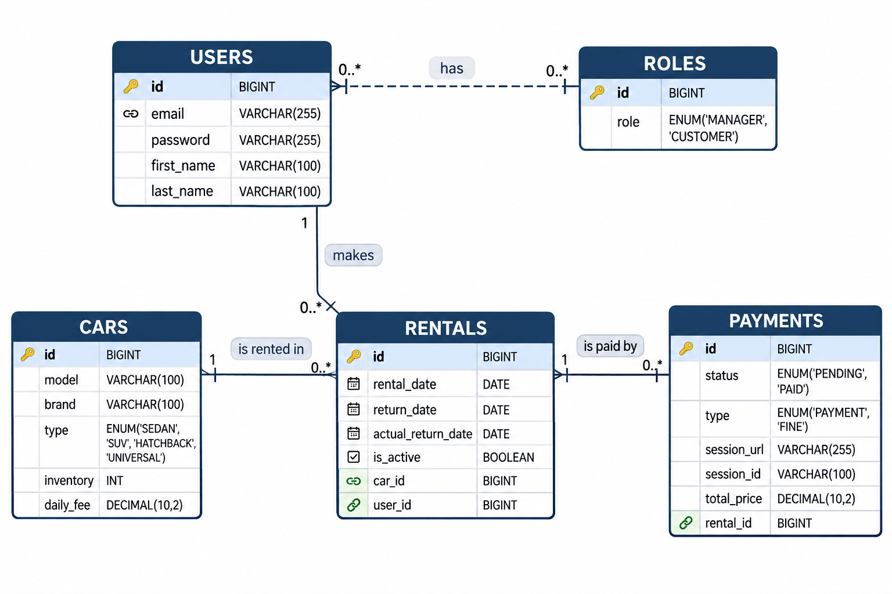

# 🚗 Car Sharing App

A backend for a car sharing service: customers browse the car catalog, rent a car for a number of days and pay for the rental online through Stripe, while managers control the fleet, rentals and payments. The service also notifies managers in a Telegram chat about new rentals and sends a daily report about overdue rentals.

## 🛠 Technologies

- **Java 21**, **Spring Boot 3.3.5** (Web, Security, Validation, Data JPA, Actuator)
- **PostgreSQL 16** with **Liquibase** migrations
- **JWT** authentication (jjwt) and role-based access control
- **Stripe API** for online payments
- **Telegram Bot API** (java-telegram-bot-api) for notifications
- **Lombok** and **MapStruct**
- **Swagger / springdoc-openapi** for API documentation
- **JUnit 5**, **Mockito**, **Spring Security Test** and **Testcontainers** for testing
- **Docker** and **Docker Compose**
- **Maven** and **Checkstyle** (Google style)

## 🏗 Architecture

The application follows a layered architecture:

- **Controller**: REST endpoints and request validation
- **Service**: business logic (cars, rentals, payments, notifications, scheduled tasks)
- **Repository**: Spring Data JPA repositories and specifications for rental search
- **Model**: JPA entities
- **DTO / Mapper**: request and response objects and MapStruct mappers
- **Security**: JWT filter, `UserDetailsService` and `SecurityConfig`
- **Exception**: global exception handler with unified error responses

### Database schema


## 🔐 Roles

| Role       | Description                                                 |
|------------|-------------------------------------------------------------|
| `CUSTOMER` | Registers, rents cars, sees own rentals and pays for them   |
| `MANAGER`  | Manages the car catalog, manages rentals and views payments |

## 🔔 Telegram notifications

The application sends messages to a Telegram chat through a bot (`MY_BOT_TOKEN`, `MY_CHAT_ID`):

- **New rental**: a message with the details of the rental is sent when a rental is created.
- **Daily overdue check**: a scheduled job (`ScheduleService`) runs once a day, finds all overdue rentals (rentals whose return date has passed) and sends them in a single message. If there are none, it sends `No rentals overdue today!`.
- **Delivery errors**: if Telegram rejects a message, a `NotificationException` is thrown with the reason returned by the Telegram API.

The time of the daily check is set by a cron expression in `ScheduleServiceImpl` (`DAILY_CHECKING_TIME`) and uses the server's time zone.

## 📡 API endpoints

All endpoints are served under the `/api` context path.

### Authentication

| Method | Endpoint             | Access | Description                |
|--------|----------------------|--------|----------------------------|
| POST   | `/auth/registration` | Public | Register a new user        |
| POST   | `/auth/login`        | Public | Log in and receive a JWT   |

### Cars

| Method | Endpoint      | Access        | Description                          |
|--------|---------------|---------------|--------------------------------------|
| GET    | `/cars`       | Public        | Get a paginated list of cars         |
| GET    | `/cars/{id}`  | Authenticated | Get a car by id                      |
| POST   | `/cars`       | Manager       | Create a new car                     |
| PUT    | `/cars/{id}`  | Manager       | Update a car                         |
| DELETE | `/cars/{id}`  | Manager       | Delete a car                         |

### Rentals

| Method | Endpoint          | Access        | Description                                    |
|--------|-------------------|---------------|------------------------------------------------|
| POST   | `/rentals`        | Authenticated | Create a rental (1–10 days)                    |
| GET    | `/rentals/list`   | Authenticated | Get rentals of the current user                |
| GET    | `/rentals`        | Manager       | Search rentals by `ids` and/or `isActive`      |
| GET    | `/rentals/{id}`   | Manager       | Get a rental by id                             |
| PUT    | `/rentals/return` | Manager       | Set the return of a rental                     |

### Payments

| Method | Endpoint            | Access        | Description                                        |
|--------|---------------------|---------------|----------------------------------------------------|
| POST   | `/payments`         | Authenticated | Create a payment and get a Stripe checkout session |
| GET    | `/payments/{id}`    | Manager       | Get all payments of a user by user id              |
| GET    | `/payments/success` | Authenticated | Handle a successful Stripe payment (`sessionId`)   |
| GET    | `/payments/cancel`  | Authenticated | Handle a cancelled payment                         |

> 💳 To test a successful payment, use the Stripe test card `4242 4242 4242 4242` with any future expiry date and any CVC.

## 🚀 Getting started

### Prerequisites

- Java 21
- Maven (or the included `mvnw` wrapper)
- Docker and Docker Compose
- A Stripe account (test mode) and a Telegram bot

### 1. Clone the repository

```bash
git clone https://github.com/<your-username>/car-sharing-app.git
cd car-sharing-app
```

### 2. Configure environment variables

Copy `.env.template` to `.env` and fill in the values:

```env
MY_BOT_TOKEN=               # Telegram bot token
MY_CHAT_ID=                 # Telegram chat id for notifications

MY_STRIPE_SECRET_KEY=       # Stripe secret key (test mode)

MY_DOMAIN=                  # Base URL used for Stripe success/cancel redirects

MY_POSTGRES_USER=
MY_POSTGRES_PASSWORD=
MY_POSTGRES_DATABASE=
MY_POSTGRES_LOCAL_PORT=
MY_POSTGRES_DOCKER_PORT=
MY_TIME_ZONE=

MY_SPRING_LOCAL_PORT=
MY_SPRING_DOCKER_PORT=
MY_DEBUG_PORT=
```

### 3. Run with Docker

```bash
./mvnw clean package -DskipTests
docker compose up --build
```

The database schema is created automatically by Liquibase on startup.

### 4. API documentation

Once the application is running, open Swagger UI:

```
http://localhost:<MY_SPRING_LOCAL_PORT>/api/swagger-ui.html
```

Authorize in Swagger with the token received from `/auth/login` (`Bearer <token>`).

## 🧪 Tests

The project contains repository, service and controller tests:

- **Repository tests** run against a real PostgreSQL in Testcontainers (Docker must be running)
- **Service tests** use Mockito
- **Controller tests** use `@WebMvcTest` with the real security configuration and cover validation, role-based access (401/403) and error handling

```bash
./mvnw test
```

## ✅ Code style

The project is checked with Checkstyle (Google style). The configuration is located in `config/checkstyle`.
